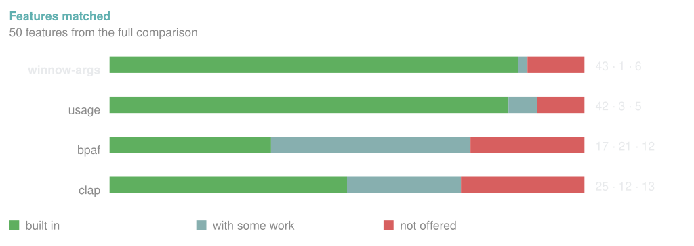

# winnow-args

[](#license)
[](https://crates.io/crates/winnow-args)
[](https://docs.rs/winnow-args)
[](https://github.com/lu-zero/winnow-args/actions/workflows/ci.yml)
[](https://deps.rs/repo/github/lu-zero/winnow-args)

Command line parsing built from [winnow](https://github.com/winnow-rs/winnow)
parsers, with a derive.

winnow-args parses a command line faster than usage, bpaf and clap. It covers
most of what their derives offer, and adds what none of them has built in: the
conventions of shell builtins and of GNU `ld`.

How to use it is in [`winnow-args/README.md`](./winnow-args/README.md) and the
crate docs; this page is about the repository.

## Features

Of the 50 features in the full comparison, winnow-args builds in 43, offers 1
with some work and lacks 6. usage is close behind; bpaf and clap cover fewer.



<details>
<summary>All 50 features, compared with usage, bpaf and clap</summary>

`✓` built in · `~` possible with some work, or in a companion crate · `–` not
offered. Read from the projects' documentation: usage 7.4, bpaf 0.9, clap 4.

**How the parser is made**

| | winnow-args | usage | bpaf | clap |
|---|:-:|:-:|:-:|:-:|
| Derive | ✓ | ✓ | ✓ | ✓ |
| Parser generated at compile time | ✓ | ✓ | – | – |
| Combinators, without a macro | ✓ | – | ✓ | ~ builder |
| A CLI built at runtime | – | ✓ `usage-lib`, `usage-dynamic` | ✓ | ✓ builder |
| Words borrowed, not copied | ✓ | ✓ | – | – |
| Non-UTF-8 values | ✓ Unix | ✓ | ✓ | ✓ |

**Flags and values**

| | winnow-args | usage | bpaf | clap |
|---|:-:|:-:|:-:|:-:|
| Short bundles, aliases, counts | ✓ | ✓ | ✓ | ✓ |
| Repeated and delimited values | ✓ | ✓ | ~ no delimiter | ✓ |
| Value enums, choices | ✓ | ✓ | ~ `FromStr` | ✓ |
| `env`, defaults | ✓ | ✓ | ✓ | ✓ |
| Optional value (`--color[=WHEN]`) | ✓ | ✓ | ~ | ✓ |
| `require_equals`, hyphen values, negative numbers | ✓ | ✓ | ~ | ✓ |
| `--no-x` negation | ✓ | ✓ | ~ | ~ |
| A flag taking several words, a fixed number or a range | ✓ | ✓ | ~ | ✓ |
| Custom value parser in the derive | ✓ `parse_with` | ~ `FromStr` type | ✓ | ✓ |
| Defaults computed, or depending on another flag | ✓ | ✓ | ~ | ✓ |

**Shell and linker conventions**

| | winnow-args | usage | bpaf | clap |
|---|:-:|:-:|:-:|:-:|
| `+x` options (shell builtins) | ✓ | – | ~ | – |
| Long options with one dash (GNU `ld`) | ✓ | – | ~ | – |
| Keyword vocabularies (`-z now`) | ✓ | – | ~ | – |
| Flags kept in command-line order | ✓ | ~ ordered group | ~ | ~ indices |
| Unknown flags kept as words, or collected | ✓ | ✓ | ~ | ~ |
| Sigil arguments, clauses | – | ✓ | ~ | – |
| Response files (`@file`) | ✓ | ✓ | – | ~ |

Unknown flags are errors here unless `unknown_flags = "value"`; usage keeps
the word. That default is a decision in
[`CHECKLIST.md`](./docs/CHECKLIST.md). `OsString` and `PathBuf` keep non-UTF-8
bytes on Unix only.

**Positionals and subcommands**

| | winnow-args | usage | bpaf | clap |
|---|:-:|:-:|:-:|:-:|
| Positionals, `--`, a trailing list | ✓ | ✓ | ✓ | ✓ |
| Words after `--` only, or `--` kept | ✓ | ✓ | ~ | ✓ |
| Subcommands, nested, with aliases | ✓ | ✓ | ✓ | ✓ |
| A subcommand declared as a variant with fields | ✓ | ✓ | ✓ | ✓ |
| Global flags | ✓ | ✓ | – (0.10: ✓) | ✓ |
| Shared flags (`flatten`) | ✓ | ✓ | ✓ | ✓ |
| Default subcommand | ✓ | ✓ | ~ | ~ |
| External subcommands, multicall | ✓ | ✓ | ~ | ✓ |
| Subcommands discovered at runtime | – | ✓ | ~ | ~ |

**Rules**

| | winnow-args | usage | bpaf | clap |
|---|:-:|:-:|:-:|:-:|
| Conflicts, requirements, groups | ✓ | ✓ | ~ by composition | ✓ |
| Conditional requirements (`required_if`) | ✓ | ✓ | ~ | ✓ |
| Flag constraints checked at compile time | ✓ | – | ~ types | – |
| Cross-field validation hook | ✓ `validate` | ✓ | ✓ `guard` | ~ |

**Help, errors, completion**

| | winnow-args | usage | bpaf | clap |
|---|:-:|:-:|:-:|:-:|
| Help from doc comments, wrapped, coloured | ✓ | ✓ | ✓ | ✓ |
| Help prose left out of the binary by a feature | ✓ | ~ help as a whole | – | – |
| Examples, a paragraph under a heading, a flag's note and warning | ✓ | ✓ | ~ | ~ after-help text |
| Subcommands laid out on their parent's page | ✓ | ✓ | – | ✓ |
| The default subcommand's page after the root's | ✓ | ✓ | – | – |
| "Did you mean" suggestions | ✓ | ✓ | ✓ | ✓ |
| Completion scripts | ✓ | ✓ | ✓ | ~ `clap_complete` |
| Completion of values by hint or function | ✓ | ✓ | ✓ | ~ |
| Man pages, markdown | ~ `winnow-args-man`, `-markdown` | ✓ | ✓ | ~ `clap_mangen` |
| Deprecated flags with warnings | ✓ | ✓ | – | – |

**Around the parser**

| | winnow-args | usage | bpaf | clap |
|---|:-:|:-:|:-:|:-:|
| A portable spec of the CLI | – | ✓ | – | – |
| Config-file settings | – | ✓ | – | – |
| Generated dispatch | ✓ `run`, `run_async` | ✓ | – | – |
| Update a parsed value from another line | – | ✓ | – | ✓ |

</details>

[`docs/COMPARISON.md`](./docs/COMPARISON.md) has the same tables on a page of
their own; keep the two in sync.

## Performance

Two command lines: `example -v --path /tmp/x a b c`, for
[a small CLI](./benchmarks/src/lib.rs) written once per framework, and
`mise use -g node@20` with [mise's 211 commands](./benchmarks/shadows/)
declared. Instructions for one parse in a fresh process, and time per parse in
a hot loop.


| | example, instructions | time | mise, instructions | time |
|---|---:|---:|---:|---:|
| winnow-args | 2 962 | 207 ns | 4 164 | 365 ns |
| usage 7 | 5 233 | 494 ns | 7 408 | 782 ns |
| clap 4 | 134 882 | 15.0 µs | 4 886 044 | 755 µs |
| bpaf 0.9 | 142 110 | 14.9 µs | 21 866 995 | 2.63 ms |

Parse time comes first here: a feature costs nothing to a program that does
not use it, and each one was measured as it was added.

**Details:** [method, sizes and every line](./benchmarks/README.md) ·
[per-feature history](./docs/PERF.md) · `just bench-shell` and `just bench-ld`
measure the brush and mold ports.

## Crates

- `winnow-args/`: the runtime, published.
- `winnow-args-derive/`: the derives, published; used through `winnow-args`.
- `winnow-args-spec/`, `winnow-args-man/`, `winnow-args-markdown/`: a derived
  command read back from what the derive writes at compile time, and its man
  and markdown pages. [`examples/`](./examples/README.md) shows the generator.
- `benchmarks/` (unpublished): the same command lines in winnow-args, usage, bpaf
  and clap, for `just perf`.
- `xtask/` (unpublished): the generators for the mold port, the examples and
  the mise shadow.
- `scripts/`: the generators of the three figures under `docs/`.

[`docs/ARCHITECTURE.md`](./docs/ARCHITECTURE.md) shows how they fit together.

## Examples

```
cargo run --example example -- -vp /tmp
cargo run --example help -- --help
cargo run --example brush_builtins -- set -eu +x -o pipefail a b
cargo run --example ld -- -shared -o out.so --as-needed -lc a.o -z now
```

The sources are in [`examples/`](./examples/). `brush_builtins` and `ld` print
what they parse, and say what to expect with `--help`. They are generated
(`just gen examples BRUSH_DIR MOLD_DIR`) from two ports:

- [brush](https://github.com/reubeno/brush), a bash-compatible shell: every
  builtin and the shell's own command line, its compatibility suite unchanged.
- [mold](https://github.com/rui314/mold), a linker: its whole option set
  behind a feature, its test suite unchanged.

## Documents

- [`docs/ARCHITECTURE.md`](./docs/ARCHITECTURE.md): an overview of the code, with a
  diagram.
- [`docs/DESIGN.md`](./docs/DESIGN.md): why it is built this way.
- [`docs/CHECKLIST.md`](./docs/CHECKLIST.md): what is done, what is not, and
  where we chose a side.
- [`docs/PERF.md`](./docs/PERF.md): measurements, one entry per feature.
- [`docs/COMPARISON.md`](./docs/COMPARISON.md): features next to usage's,
  bpaf's and clap's.
- [`CHANGELOG.md`](./CHANGELOG.md): what changed in each release.
- [`CONTRIBUTING.md`](./CONTRIBUTING.md): building, testing, measuring.

## License

MIT or Apache-2.0, at your option: [`LICENSE-MIT`](./LICENSE-MIT),
[`LICENSE-APACHE`](./LICENSE-APACHE).
