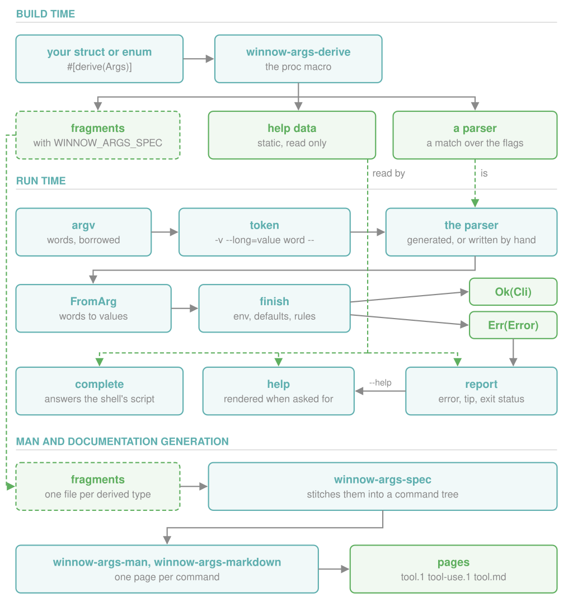

# Architecture

An overview of the code: what the derive generates, how a command line is
parsed, and how the man and markdown pages are generated.
[DESIGN.md](./DESIGN.md) explains why it is built this way.

## Build time

`#[derive(Args)]` is expanded by `expand` in
`winnow-args-derive/src/lib.rs`. For a struct it generates an
`impl winnow_args::Args` with two items:

- `parse_argv_with`, a loop around one `match` on the next token, with an
  arm for each flag of the struct;
- `HELP`, a `static` [`help::Command`] listing the flags, positionals and
  subcommands with their doc comments.

`#[derive(Subcommand)]` generates the `match` on the subcommand's name, and
`#[derive(ValueEnum)]` an `impl FromArg` for the enum.

If the environment variable `WINNOW_ARGS_SPEC` is set during the build, each
derive also writes a TOML file describing its type
(`winnow-args-derive/src/spec.rs`). These files are only used to generate
documentation.

## Run time

Taking `tool -v use node@22` as the example, with `-v` a global flag of
`tool` and `use` a subcommand:

| Step | Code | What happens |
|---|---|---|
| 1 | `stream.rs`, `Argv` | The arguments are wrapped as a slice of borrowed words: `-v`, `use`, `node@22`. |
| 2 | `token.rs`, `arg` | The next word is classified: `-v` is a short flag, `use` and `node@22` are plain words. |
| 3 | generated `parse_argv_with` of `tool` | `-v` matches an arm and sets the field. `use` names a subcommand, so the rest of the input is passed to its parser. |
| 4 | generated `parse_argv_with` of `use` | `node@22` is its positional. A flag it does not declare is offered to the global flags of `tool` through the `Globals` trait. |
| 5 | `value.rs`, `FromArg` | Each value is converted from bytes to the field's type. |
| 6 | end of each `parse_argv_with` | Missing fields are filled from `env` and `default`, then `conflicts`, `requires` and `required` are checked. |

The result is `Ok(Cli)` or an [`Error`] (`error.rs`). `--help` and
`--version` are returned as errors as well; `report` in `lib.rs` prints the
help page, the version or the error message and returns the exit status.

`HELP` is not touched during a successful parse. It is read in three cases:

- `help.rs` renders it when help is requested;
- `error/suggest.rs` searches it for a flag or subcommand close to an unknown
  one, to add the `tip:` line;
- `complete.rs` uses it to answer the completion script, which runs
  `tool __complete_word__ --shell SHELL --line LINE`.

`combinator.rs` provides the same building blocks as winnow parsers, for a
command line written without the derive.

## Man and documentation generation

`winnow-args-spec` loads the TOML files (`Catalog::load`) and resolves the
references between them (`Catalog::stitch`) into a tree of commands.
`winnow-args-man` and `winnow-args-markdown` each render one page per command
from that tree.

Since the files are written by `cargo check`, the program is never linked or
run, and the pages can be generated for a target that cannot be executed on
the build machine.

[`help::Command`]: https://docs.rs/winnow-args/latest/winnow_args/help/struct.Command.html
[`Error`]: https://docs.rs/winnow-args/latest/winnow_args/struct.Error.html
